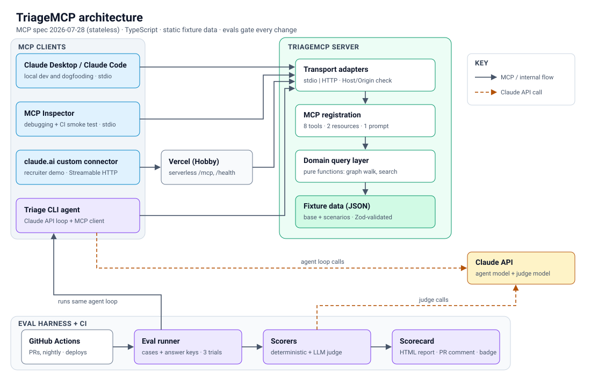

# TriageMCP

> An MCP server that lets an AI assistant triage outages for a fictional SaaS company,
> with evals that prove it picks the right tools and finds the real root cause.

 



## Proof it works

| Model             | Pass rate | Hallucinated IDs | Guardrail violations | Cost/run |
| ----------------- | --------- | ---------------- | -------------------- | -------- |
| Claude Sonnet 5.5 | xx%       | 0                | 0                    | $x.xx    |
| Claude Haiku 5.5  | xx%       | 0                | 0                    | $x.xx    |

## Try it in 60 seconds

1. In Claude, add a custom connector with URL `https://<host>/mcp`
2. Ask: "Checkout is slow. What's going on?"

More sample questions: ...

No Claude access? Read an example transcript: [docs/transcripts/checkout-latency.md](docs/transcripts/checkout-latency.md)

## Run locally

```sh
pnpm install
pnpm test          # deterministic tests, no API key needed
pnpm triage "Checkout is slow, what's going on?"
pnpm eval          # needs ANTHROPIC_API_KEY
```

## How it's built

- Tools, resources, prompt: [docs/API.md](docs/API.md)
- Eval design: [EVALS.md](EVALS.md)
- Design decisions: [DECISIONS.md](DECISIONS.md)

## The fictional company

All data is synthetic. Fernhill is not a real company.
